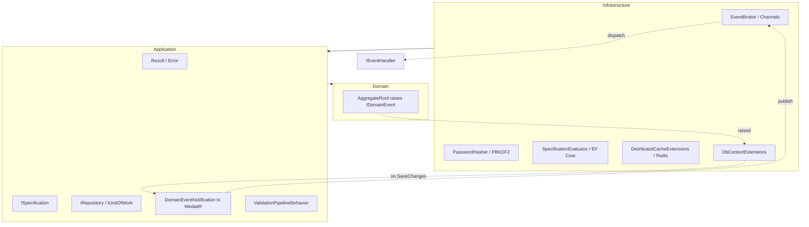

# Software Specification: EGL Util — Enterprise .NET Architecture Library (C# 12 / .NET 8)

> Rendered from the intake interview (Phase 5). Frozen contract: diverging implementation
> updates this spec in the same PR or adds an ADR superseding the relevant section.

## 1. Objective & Business Context

egl-util-csharp is a NuGet utility library of strongly-typed, immutable, extensible architectural building blocks for .NET applications that adopt Domain-Driven Design, Clean Architecture, and CQRS. It removes the boilerplate of re-implementing entities, value objects, aggregates, the Result error-handling pattern, repositories / specifications / unit-of-work, an in-memory event broker, password hashing, validation, and two-level caching, so teams focus on domain logic with compile-time safety instead of re-deriving the same scaffolding per project.

## 2. Functional Requirements

- `Entity<TId>` — abstract base with identity-based equality (equal iff same type and `Id`) and a strongly-typed `Id`.
- `ValueObject` — abstract base with structural value equality and matching `GetHashCode`, derived from an explicit `GetEqualityComponents()` sequence.
- `AggregateRoot<TId>` — extends `Entity<TId>`; accumulates domain events in a read-only `DomainEvents` collection via `RaiseDomainEvent` / `ClearDomainEvents`.
- `IDomainEvent` — marker interface for domain events carrying an occurred-on timestamp sourced from `IDateTimeProvider`.
- `DomainEventNotification<TEvent>` — adapts an `IDomainEvent` into a MediatR `INotification` so domain events dispatch as application notifications.
- `Result` — success/failure of an operation without throwing; exposes `IsSuccess`/`IsFailure` and an ordered `Errors` collection (with an `Error` convenience for the first), via `Success()`/`Failure(params Error[])` factories.
- `Result<TValue>` — generic result carrying a guarded success `Value` and the failure `Errors`, with implicit conversion from `TValue` and from `Error`.
- `Error` — immutable `record` of `Code` + `Message`, value-equal, defining a canonical `Error.None`.
- `Result.Combine` — aggregates many results into one that succeeds iff all succeed, else returns the collected errors.
- `IRepository<TEntity, TId>` — generic CRUD abstraction (`GetByIdAsync`, `ListAsync`, `Add`, `Update`, `Remove`) over an aggregate root.
- `ISpecification<TEntity>` — Specification pattern: criteria expression, includes, ordering, and paging, isolating LINQ/EF Core query shape.
- `SpecificationEvaluator` — applies an `ISpecification<TEntity>` to an `IQueryable<TEntity>`, composing criteria, includes, ordering, and paging deterministically.
- `IUnitOfWork` — atomic transaction boundary; `SaveChangesAsync` commits all tracked changes as one unit.
- `DbContextExtensions` — extracts pending domain events from tracked aggregates and publishes them around `SaveChanges`, clearing them on success.
- `IEventBroker` — asynchronous in-memory publish abstraction (`PublishAsync<TEvent>`) that does not block the caller.
- `EventBroker` — `System.Threading.Channels`-backed implementation with a background consumer: thread-safe, bounded back-pressure, ordered per-channel delivery.
- `IEventHandler<TEvent>` — consumer contract (`HandleAsync(TEvent, CancellationToken)`) resolved per event type.
- `IPasswordHasher` — algorithm-agnostic abstraction for secure password hashing and verification (`Hash`, `Verify`).
- `PasswordHasher` — PBKDF2 implementation with per-password random salt, configurable high iteration count, and constant-time verification.
- `ValidationPipelineBehavior<TRequest, TResponse>` — MediatR pipeline behavior running all FluentValidation validators and short-circuiting on failure.
- `ICacheService` — two-level (in-memory + distributed/Redis) cache abstraction with `GetOrCreateAsync`, TTL, and key-based invalidation.
- `DistributedCacheExtensions` — typed get/set over `IDistributedCache` using compact System.Text.Json serialization.
- `IDateTimeProvider` / `DateTimeProvider` — injectable abstraction over `DateTime.UtcNow` to make system time deterministic in tests.
- `ServiceCollectionExtensions` — assembly-scanning auto-registration of handlers, validators, and specifications into `IServiceCollection`.
- `PaginatedList<T>` — encapsulates a page of results with `Items`, `PageIndex`, `TotalCount`, `TotalPages`, `HasNext`/`HasPrevious`.

## 3. Non-Functional Requirements

- Compile-time type safety: generic, strongly-typed surface; nullable reference types enabled and treated as errors (`dotnet build -warnaserror`).
- Immutability: `Error`, value objects, and domain events are immutable (records / init-only); no post-construction mutation of value types.
- No exceptions for expected control flow: failures flow through `Result`; exceptions are reserved for programmer errors.
- Thread safety: `EventBroker` is safe for concurrent publishers with documented delivery and ordering guarantees.
- Security: `PasswordHasher` uses PBKDF2 with >= 600,000 iterations (OWASP 2024), >= 128-bit random salt, and constant-time verification.
- Test determinism: time is injected via `IDateTimeProvider`; no `DateTime.UtcNow` in shipped logic.
- Dependency policy: the domain layer has zero third-party dependencies; outer layers depend only on MediatR, FluentValidation, EF Core, and Microsoft.Extensions abstractions.
- Portability: targets `net8.0`; builds and tests green on Linux, Windows, and macOS under .NET 8.
- Quality gates: >= 80% line coverage (coverlet), `dotnet format` clean, Roslyn analyzers as errors, deterministic build.
- API stability: the public surface is frozen at 1.0 and protected by SemVer.

## 4. Logical Architecture & Core Algorithm

Clean / Onion architecture: dependencies point inward toward the domain. The package is organised into three layers, separated by namespace under `It.D4np.Util`:

- Domain (`It.D4np.Util.Domain`) — Entity<TId>, ValueObject, AggregateRoot<TId>, IDomainEvent, and the functional Result/Result<T>/Error model. Zero external dependencies.
- Application (`It.D4np.Util.Application`) — ISpecification<T>, IRepository<TEntity,TId>, IUnitOfWork, IEventBroker, ICacheService, IDateTimeProvider, DomainEventNotification<TEvent>, IPasswordHasher, ValidationPipelineBehavior, PaginatedList<T>. Depends on Domain plus the MediatR / FluentValidation abstractions.
- Infrastructure (`It.D4np.Util.Infrastructure`) — SpecificationEvaluator (EF Core), EventBroker (Channels), PasswordHasher (PBKDF2), CacheService (two-level in-memory + distributed), DistributedCacheExtensions (Redis/JSON), DbContextExtensions, DateTimeProvider, ServiceCollectionExtensions. Depends on Application plus concrete tech.

Dependency direction and the domain-event flow:

## 5. Public Interface

Consumers import via `using It.D4np.Util;`. The public surface:

- `Entity<TId>`, `AggregateRoot<TId>`, `ValueObject` — domain primitives.
- `IDomainEvent`, `DomainEventNotification<TEvent>` — domain-event surface.
- `Result`, `Result<TValue>`, `Error`, `Result.Combine(...)` — functional error model.
- `IRepository<TEntity, TId>`, `ISpecification<TEntity>`, `SpecificationEvaluator` — query/persistence.
- `IUnitOfWork`, `DbContextExtensions` — transaction + event dispatch.
- `IEventBroker`, `EventBroker`, `IEventHandler<TEvent>` — in-memory pub/sub.
- `IPasswordHasher`, `PasswordHasher` — password hashing.
- `ValidationPipelineBehavior<TRequest, TResponse>` — MediatR validation.
- `ICacheService`, `DistributedCacheExtensions` — two-level caching.
- `IDateTimeProvider`, `DateTimeProvider`, `PaginatedList<T>` — utilities.
- `ServiceCollectionExtensions.AddD4npUtil(...)` — DI auto-registration.

## 6. Verification & Test Strategy

Every public type has xUnit unit tests; FsCheck property tests assert the `ValueObject` equality laws (reflexive/symmetric/transitive) and `Result.Combine` identity/associativity. `PasswordHasher` has known-answer and round-trip tests plus assertions on iteration count (>= 600k) and salt uniqueness. `SpecificationEvaluator` is tested against EF Core InMemory and SQLite providers; the Redis cache layer is integration-tested via Testcontainers. `EventBroker` has a multi-threaded test asserting exactly-once delivery from N concurrent publishers. CI enforces nullable + analyzers as errors (`dotnet build -warnaserror`), `dotnet format --verify-no-changes`, coverage >= 80% (coverlet), across a Linux/Windows/macOS .NET 8 matrix. Each functional requirement maps to a test; the security, coverage, and format gates run on every PR.

Toolchain: built with dotnet SDK (MSBuild), Directory.Build.props, tested with xUnit (+ FsCheck for property tests), checked with
Nullable reference types + Roslyn analyzers (soundness); dotnet-counters (leaks), coverage target ≥ 80% line. Every functional and
non-functional requirement above maps to a CI gate (see [`.github/workflows/ci.yml`](../../.github/workflows/ci.yml)).
